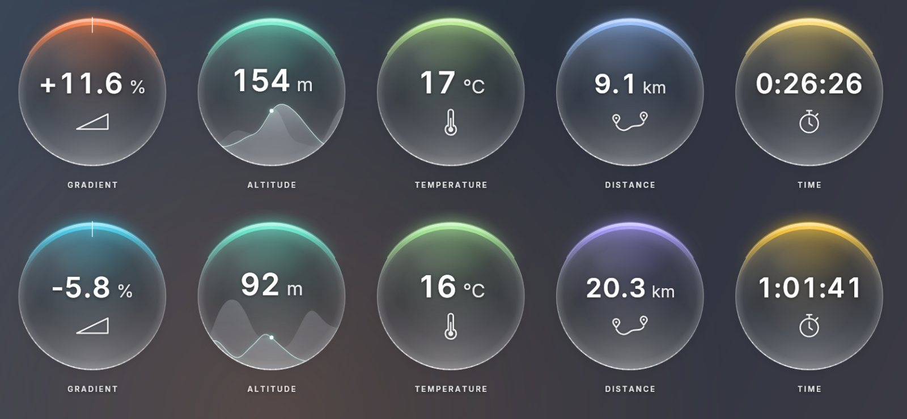
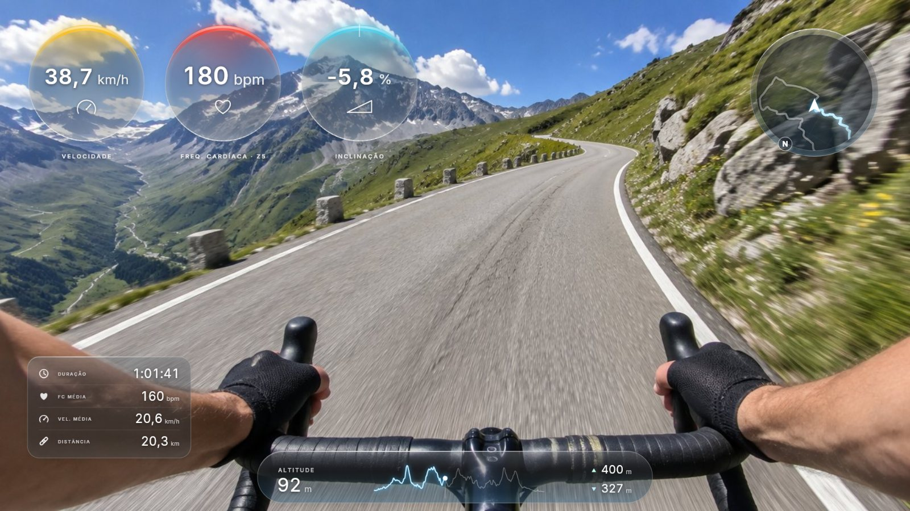
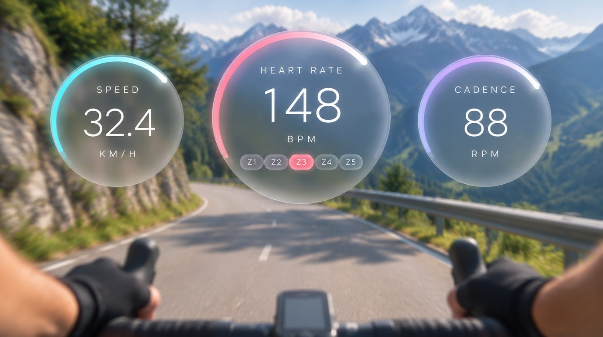
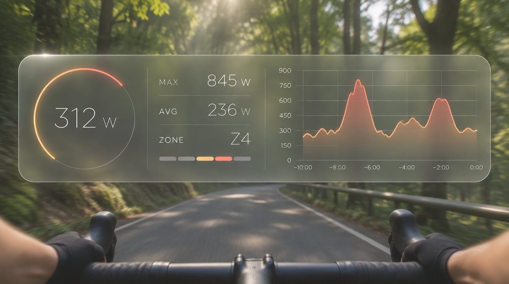
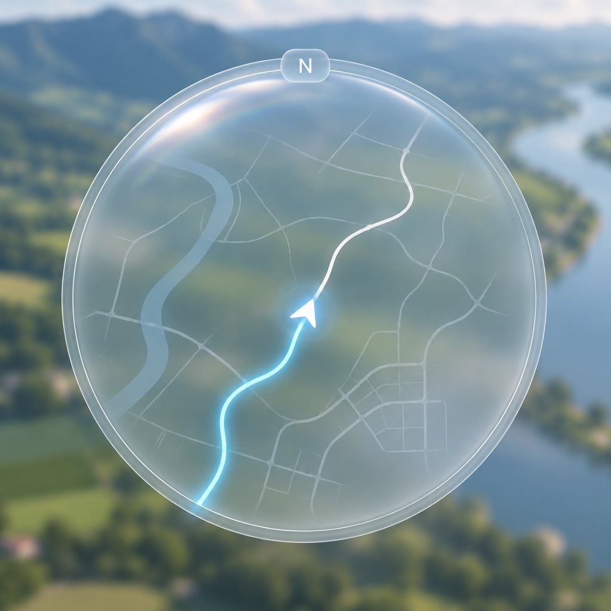
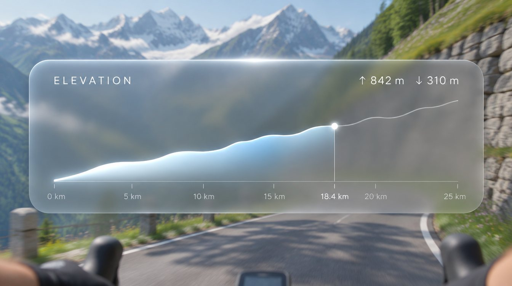
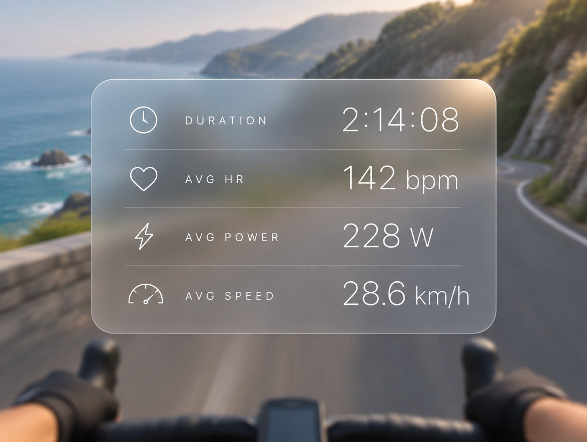
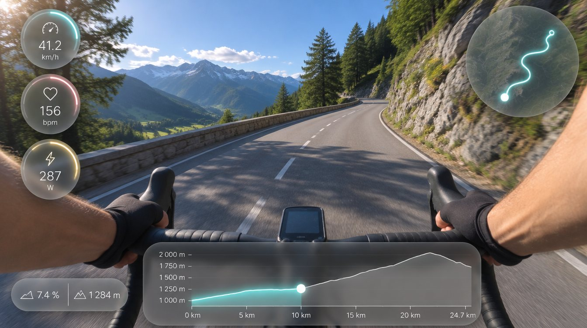
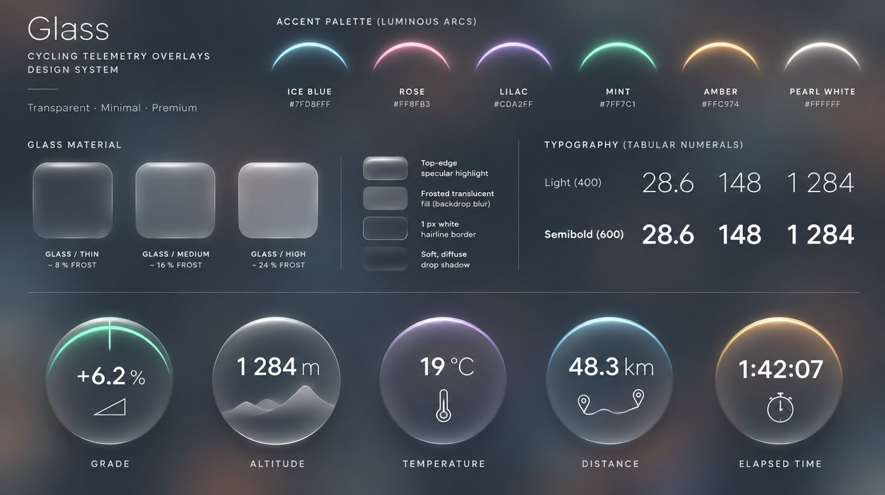
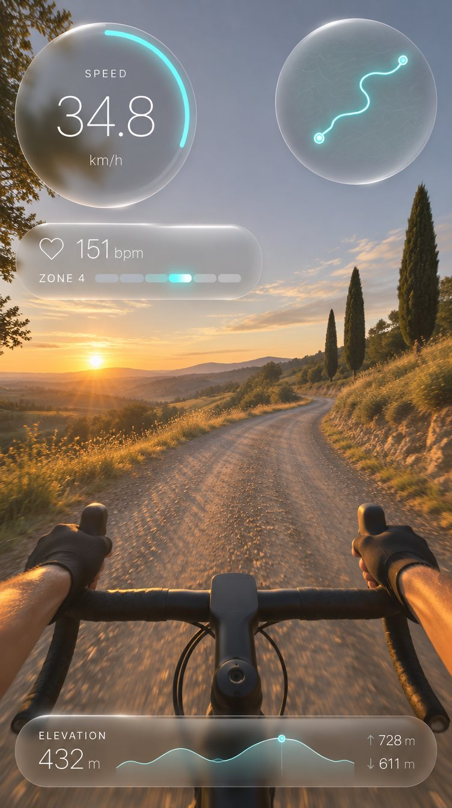

# Tema Vidro (Glass)

Versões em vidro, transparentes, de todos os gadgets com métricas. A ideia é elegância e transparência: o vídeo continua a ser o protagonista.

> **Estado: pronto mas não oferecido.** O tema está todo feito e testado, mas não aparece nas apps. Para o ativar, acrescente `'glass'` a `OVERLAY_THEMES` em [`packages/core/src/overlays/types.ts`](../../packages/core/src/overlays/types.ts) (a seguir a `'default'`): aparece o separador **Vidro** no passo 4 (desktop) e a categoria **Vidro** nos gadgets (telemóvel).





## Mostradores

Esfera de vidro transparente com uma **meia-lua de luz** no topo, o número com a unidade ao centro, um ícone de traço fino por baixo e o nome por baixo da esfera (como a referência `07-sistema.jpg`).

A cor da meia-lua (e do brilho que entra na esfera) **muda com o valor, sem cortes**, misturando-se entre as cores de referência:

| Métrica | Escala |
|---|---|
| Inclinação | azul abaixo de −15 % → ciano → verde no plano → amarelo → laranja → vermelho acima de +15 % (marca de nível no topo) |
| FC | cor da zona em que está (as zonas e cores das definições), a misturar ±3 bpm em cada limite; a zona aparece no nome (`FREQ. CARDÍACA · Z3`) |
| Potência | cor da zona de potência (FTP), a misturar ±3 % do FTP nos limites; zona no nome; W/kg no lugar do ícone quando ativo |
| Velocidade | azul parado → verde ~24 km/h → amarelo → vermelho acima de ~60 km/h |
| Cadência | azul abaixo de 60 rpm → verde 85–95 → vermelho acima de ~115 |
| Temperatura | azul abaixo de 0 °C → verde ~14 °C → amarelo → vermelho acima de ~37 °C |
| Altitude | verde-mar perto do mar → dourado nas serras → laranja → lilás → branco-neve acima de 3000 m |
| Distância / tempo | progresso da volta: azul-gelo → lilás → rosa / dourado → âmbar → laranja |

No mostrador de **altitude**, em vez de uma montanha fixa, passa o **perfil de altimetria** à volta do ciclista como duas cordilheiras suavizadas (perto: ±2 km, longe: ±7 km, mais pálida), com o ciclista marcado no cume do meio.

## Outros gadgets

| Família | Gadgets |
|---|---|
| Painéis | velocidade, altitude, inclinação, FC, cadência, potência, temperatura: anel e brilho na cor do valor atual, três números da volta e gráfico fino dos últimos minutos/km |
| Mapas e perfis | mapa circular rotativo em lente de vidro, perfil de altimetria em cartão, faixa de altimetria (altitude + perfil + ganho/perda) |
| Outros | painel compacto (médias), chip de FC com a cor e as pílulas da zona |

Código em [`packages/core/src/overlays/glass/`](../../packages/core/src/overlays/glass/): `dials.ts` (esferas), `colors.ts` (escalas de cor), `icons.ts` (ícones de traço), `panels.ts`, `cards.ts`, `material.ts`.

## Referências (Higgsfield)

Geradas com o modelo GPT Image 2.6 no Higgsfield, para definir o tema antes de o desenhar em código:

| | |
|---|---|
|  |  |
|  |  |
|  |  |
|  |  |

`fundo-montanha.jpg` e `fundo-floresta.jpg` são fundos limpos (sem HUD) para rever o tema sobre "vídeo":

```bash
npx tsx packages/core/src/cli/contactSheet.ts fixtures/real/ride-0-2026-10-11-09-00-31.fit "" vidro.png pt glass docs/glass/fundo-montanha.jpg
```
