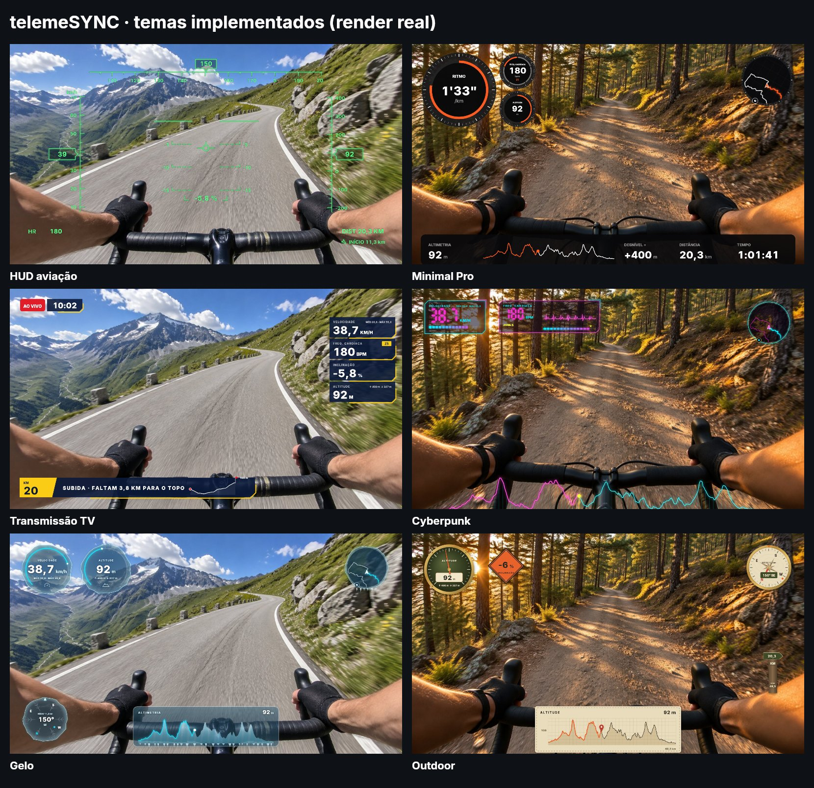
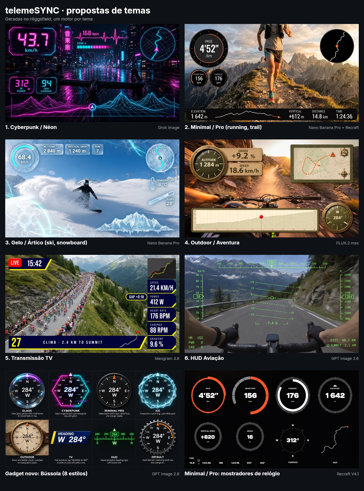

# Temas

Seis temas novos (HUD aviação, Minimal Pro, Transmissão TV, Cyberpunk, Gelo, Outdoor), a bússola e uma nova organização do passo 4. Estão **feitos mas em teste**: só aparecem com "Mostrar temas em teste" ligado.

## Como está organizado

Três eixos, sempre os mesmos:

1. **Desporto** (detetado no ficheiro, pode mudar-se): Ciclismo · Corrida e trail · Ski e snowboard · Caminhada. Decide **que métricas** aparecem (ritmo e passos/min em vez de velocidade e rpm, declive em graus, descidas e desnível no ski…) e **que temas vêm primeiro**.
2. **Tema** (o aspeto): galeria de cartões com capa ao vivo, selo do desporto, contador de gadgets escolhidos e etiqueta "em teste".
3. **Categoria** (o tipo de gadget), igual em todos os temas: Mostradores · Painéis · Mapas e perfis · Navegação (bússola) · Extras do tema · Números · Segmentos.

Por cima, uma faixa **Em uso** com os gadgets escolhidos de qualquer tema (× para tirar), para misturar temas sem se perder.

No código, cada tema novo só desenha as suas peças (mostrador, bússola, mapa, perfil, resumo e extras): os gadgets, nomes, ficheiros, categorias e desportos saem do kit partilhado, iguais para todos.

| O quê | Onde |
|---|---|
| Registo dos temas (nome, estado, desportos, cor) | `packages/core/src/overlays/themes.ts` |
| Métricas partilhadas (valor, unidade, escala, cor contínua, desportos) | `packages/core/src/overlays/kit/roles.ts` |
| Kit (interface do tema e fábrica dos gadgets) | `packages/core/src/overlays/kit/kit.ts` |
| Temas | `packages/core/src/overlays/{hud,minimal,tv,cyber,ice,outdoor}/` |
| Desporto e métricas derivadas | `packages/core/src/telemetry/sport.ts`, `packages/core/src/metrics/derived.ts` |
| Seletor do passo 4 | `apps/web/src/components/GadgetPicker.tsx` |

**Tornar um tema oficial:** em `themes.ts`, mudar o `status` desse tema de `'preview'` para `'stable'`.

## Gadgets por tema

Todos têm os mostradores das métricas do desporto, mapa circular, perfil, painel compacto e bússola (rumo + seta e distância de volta ao início). Extras:

- **HUD aviação**: HUD completo (escala de pitch = inclinação, fita de rumo, fitas de velocidade e altitude), e as peças soltas; âmbar em atenção (inclinação ≥ 15 %, zona máxima).
- **Minimal Pro**: relógio (ritmo + 2 mostradores), barra de dados em baixo.
- **Transmissão TV**: selo AO VIVO com a hora, coluna de métricas (escolhidas pelo desporto), faixa "subida · faltam X km para o topo" (usa os segmentos, senão o próximo cume).
- **Cyberpunk**: números digitais de 7 segmentos, FC com ECG, perfil synthwave.
- **Gelo**: descidas e desnível, perfil glaciar com pingentes.
- **Outdoor**: sinal de inclinação, poste de trilho com a distância.

## Propostas originais (Higgsfield)

Propostas visuais geradas no Higgsfield (26/11/2026), com o motor mais adequado a cada tema. Para cada tema há uma **cena** (sobre vídeo do desporto certo) e uma **folha de gadgets**. São referências de design, não o desenho final: o texto e alguns pormenores gerados pela IA têm erros (letras da bússola trocadas, valores repetidos), que se corrigem ao desenhar em código.

| Tema | Desporto | Motor | Cena | Gadgets |
|---|---|---|---|---|
| Cyberpunk / Néon | estrada à noite, cidade | Grok Image | [cena](cyberpunk-cena.jpg) | [gadgets](cyberpunk-gadgets.jpg) |
| Minimal / Pro (relógio) | running, trail | Nano Banana Pro (cena), Recraft V4.1 (mostradores) | [cena](minimal-cena.jpg) | [gadgets](minimal-gadgets.jpg) |
| Gelo / Ártico | ski, snowboard | Nano Banana Pro | [cena](gelo-cena.jpg) | [gadgets](gelo-gadgets.jpg) |
| Outdoor / Aventura | BTT, caminhada, gravel | FLUX.2 max | [cena](outdoor-cena.jpg) | [gadgets](outdoor-gadgets.jpg) |
| Transmissão TV | corrida (estrada, running) | Ideogram 4.6 | [cena](tv-cena.jpg) | [gadgets](tv-gadgets.jpg) |
| HUD Aviação | descidas, estrada | GPT Image 2.6 | [cena](hud-cena.jpg) | [gadgets](hud-gadgets.jpg) |

## O que cada tema traz

- **Cyberpunk / Néon**: molduras angulares, magenta e ciano, dígitos monoespaçados, linha de ECG na FC e o perfil como cordilheira em wireframe sobre uma grelha em perspetiva (o mais marcante). Fica melhor em vídeos noturnos.
- **Minimal / Pro**: mostradores de relógio pretos, um só acento laranja, números condensados grandes, barra de dados em baixo. Para running precisa de **ritmo** (min/km, a partir da velocidade), **passos/min** (a cadência de corrida vem por perna no FIT: ×2) e **velocidade vertical** (m/h, a partir da altitude).
- **Gelo / Ártico**: vidro gelado com geada, ciano e branco, perfil da descida em forma de glaciar, mapa "congelado". Dados novos para ski: **desnível da descida**, **n.º de descidas** (separar descidas de subidas de teleférico), **inclinação em graus** (a partir da inclinação em %).
- **Outdoor / Aventura**: latão, couro, papel kraft com curvas de nível, placas (sinal de inclinação, poste de trilho com a distância), mapa de campo e perfil em papel milimétrico.
- **Transmissão TV**: pacote de grafismo genérico (azul-marinho e amarelo, sem marca de nenhum canal ou corrida): "AO VIVO" com hora, faixa inferior com o dorsal e "subida · faltam 2,4 km para o topo" (dá para usar os segmentos que já existem), coluna de métricas, etiqueta de diferença.
- **HUD Aviação**: só linhas verdes finas: escala de "pitch" a mostrar a inclinação, fita de rumo no topo, fitas de velocidade e altitude dos lados. Quase tudo transparente, por isso gera ficheiros leves. Variante âmbar para avisos (inclinação > 15 %).

## Gadget novo: bússola

[Folha com a bússola nos 8 estilos](bussola-temas.jpg) (GPT Image 2.6): vidro, cyberpunk, minimal, gelo, outdoor, TV, HUD (fita) e predefinido (aro de prato). [Versão vetorial](bussola-vetor.jpg) (Recraft): mais fraca no desenho, mas traz uma boa ideia: **seta de "voltar ao início" com a distância** (ex.: "INÍCIO 3,2 km").

Os dados já existem: o rumo é o mesmo que o mapa circular usa para rodar (`roundMapHeading`), e a direção e a distância até ao início calculam-se a partir das posições GPS.
